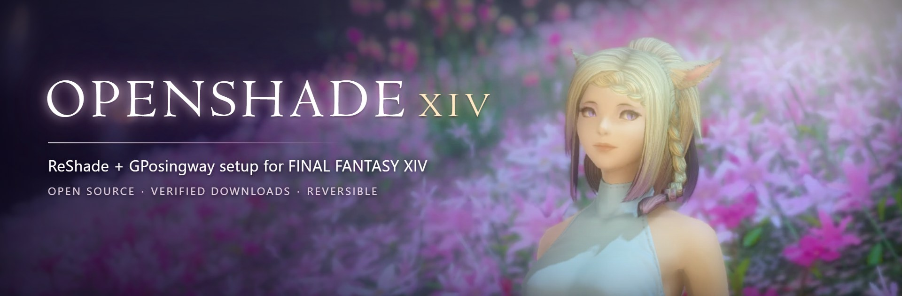

[](https://github.com/divinepleroma/openshade-xiv/actions/workflows/tests.yml)
[](https://github.com/divinepleroma/openshade-xiv/releases/latest)
[](LICENSE)

[](https://github.com/crosire/reshade)
[](https://github.com/gposingway/gposingway)

A safe, auditable installer for [ReShade](https://github.com/crosire/reshade) and [GPosingway](https://github.com/gposingway/gposingway) on FINAL FANTASY XIV, written as a single readable PowerShell script.

## Features

- **Verified downloads.** Every file is checked against a pinned SHA-256 checksum before it is used.
- **Official sources only.** ReShade and GPosingway are fetched from their own download pages. Nothing is rehosted here.
- **Nothing hidden.** One script you can open and read. No compiled program, no background process, no auto-update.
- **Finds your game.** Custom install folders, Steam libraries and XIVLauncher installs are detected without scanning your drives.
- **Reversible.** Existing files are backed up first, and **Uninstall** puts them back.
- **Checks its own work.** The install is verified when it finishes, and **Check** can repeat that at any time.

## Installation

> [!WARNING]
> The only official source for OpenShade XIV is this GitHub repository.

1. Download the zip from the [latest release](https://github.com/divinepleroma/openshade-xiv/releases/latest).
2. Right-click the zip and choose **Extract All**. Do not run it from inside the zip.
3. Close the game.
4. Open the extracted folder and run **`OpenShade.cmd`**. Choose **Yes** when Windows asks for permission, then choose **Install**.

In game, **Shift+F2** opens the ReShade menu and **Shift+F3** toggles effects.

> [!NOTE]
> Windows may ask for confirmation before running a downloaded script. OpenShade XIV is plain text, so you can open `OpenShade.ps1` in Notepad and read it first.

> [!NOTE]
> OpenShade XIV asks for administrator permission because the game is usually installed under `Program Files`, where only an administrator can add files. If your game is somewhere else, `OpenShade.cmd noadmin` runs without it.

> [!TIP]
> Not sure yet? Choose **Preview** in the menu. It walks through every step and changes nothing.

<details>
  <summary>
    <b>Requirements</b>
  </summary>

  - Windows 10 or 11, 64-bit (tested on Windows 11)
  - Windows PowerShell 5.1, which is included with Windows
  - About 1 GB of free disk space
  - FINAL FANTASY XIV, DirectX 11 client
</details>

## Usage

`OpenShade.cmd` asks for administrator permission, then opens a menu:

| Option | Purpose |
|---|---|
| **Install** | Installs, then verifies the result. Also repairs an existing install. |
| **Preview** | Shows every step. Downloads and changes nothing. |
| **Check** | Read-only. Reports whether the install is complete and whether ReShade has started with the game. |
| **Uninstall** | Removes what was installed and restores what was backed up. Offers to delete the downloads. |

Something not working? See **Troubleshooting** below, or [report a problem](https://github.com/divinepleroma/openshade-xiv/issues/new/choose).

## What gets installed

| Component | Version | Project | Downloaded from |
|---|---|---|---|
| ReShade, add-on edition | 6.8.0 | [crosire/reshade](https://github.com/crosire/reshade) | reshade.me, ReShade's own download site |
| GPosingway | 8.3.1 (release R8.2.1) | [gposingway/gposingway](https://github.com/gposingway/gposingway) | GPosingway's GitHub releases |

Versions, download addresses and SHA-256 checksums are pinned in [`manifest.json`](manifest.json). Nothing else is downloaded.

## Preview

```text
OpenShade XIV 0.4.2
ReShade + GPosingway setup for FINAL FANTASY XIV

  1. Install or repair
  2. Preview (changes nothing)
  3. Check an existing install
  4. Uninstall
  Q. Quit

Choose [1-4, Q]: 1

Installs:
  ReShade 6.8.0 (add-on edition)    https://github.com/crosire/reshade
  GPosingway 8.3.1                  https://github.com/gposingway/gposingway

Downloads are verified against the SHA-256 checksums in manifest.json.
Existing files are backed up before being replaced.

Unofficial community tool. Not affiliated with Square Enix.

Continue? [Y/N]:
```

## Details

<details>
  <summary>
    <b>How it works</b>
  </summary>

  1. **Locate game.** Reads existing records only; no drive scan. Sources: the running game process, XIVLauncher settings, the installed programs list, Steam library records, Desktop and Start menu shortcuts, recently run programs, and the default install folders. Multiple installs are listed with game version and last patch date. A folder can also be browsed for or pasted.
  2. **Existing files.** Anything that would be replaced is moved to a backup folder inside the game folder.
  3. **ReShade.** Downloads the official setup file, verifies it, and extracts `ReShade64.dll` without running the setup program. It is installed as `dxgi.dll`.
  4. **GPosingway.** Downloads the release package, verifies it, and inspects every entry before unpacking.
  5. **Install.** Lists every change and asks for confirmation first. Then allows your Windows account to change `ReShade.ini`, `ReShade.log`, the presets and the screenshot folder, as ReShade's own setup does. Without this, ReShade cannot save when the game is in a protected folder such as `Program Files`.
  6. **Verify.** Compares the installed files against the package and confirms ReShade is present and unmodified.
</details>

<details>
  <summary>
    <b>Safeguards</b>
  </summary>

  - A system check runs first and stops if the PC cannot run the tool (for example, restricted PowerShell on a managed computer).
  - Downloads are refused if the size or SHA-256 checksum does not match the manifest.
  - The package is refused if it contains a program or script, an unexpected top-level item, or a path outside the game folder.
  - The install stops if GShade is present, the game is running, the game folder is not writable, or the folder path is too long for the package.
  - A second copy of ReShade under another file name is moved to the backup.
  - Only one instance can run at a time.
  - If a run fails partway, the tool reports whether the game folder was changed and how to restore it.
</details>

<details>
  <summary>
    <b>Files and locations</b>
  </summary>

  | Location | Contents |
  |---|---|
  | `<game folder>\.openshade-xiv` | Install record and backups |
  | `%LOCALAPPDATA%\openshade-xiv` | Downloads and `log.txt` |
</details>

<details>
  <summary>
    <b>Troubleshooting</b>
  </summary>

  - **"Cannot write to the game folder".** Run `OpenShade.cmd` again and choose **Yes** when Windows asks for permission. If it happens with permission given, security software may be protecting the game folder.
  - **The script is blocked from running.** Some managed work or school PCs do not allow downloaded scripts. The tool cannot run there.
  - **No ReShade banner in game.** Choose **Check** in the menu, then see GPosingway's [troubleshooting guide](https://github.com/gposingway/gposingway/blob/main/md/troubleshooting.md).
  - **ReShade says "Unable to save configuration and/or current preset", or screenshots are not saved.** The game is in a protected folder and the install was made with version 0.4.1 or older. Download the latest release, run `OpenShade.cmd`, choose **Yes** when Windows asks for permission, and choose **Install**. Start the tool from the Windows account you play on.
  - **An install stopped partway.** Choose **Install** to repair it, or **Uninstall** to put the game folder back as it was.
  - **Still stuck.** [Report a problem](https://github.com/divinepleroma/openshade-xiv/issues/new/choose) and include `%LOCALAPPDATA%\openshade-xiv\log.txt`. The log contains folder paths, which can include your Windows user name.
</details>

<details>
  <summary>
    <b>Updating</b>
  </summary>

  Each release installs the ReShade and GPosingway versions listed in its `manifest.json`. To update:

  1. Download the zip from the [latest release](https://github.com/divinepleroma/openshade-xiv/releases/latest) and extract it.
  2. Close the game, run **`OpenShade.cmd`**, and choose **Install**.

  The previous `ReShade.ini`, `reshade-presets` and `reshade-shaders` are moved to `<game folder>\.openshade-xiv\backup`, in a folder ending in `-previous-install`. Presets you saved yourself are in there; copy back the ones you want.
</details>

<details>
  <summary>
    <b>Uninstalling</b>
  </summary>

  1. Copy any presets you want to keep out of `reshade-presets`. Uninstall removes that folder.
  2. Close the game, run **`OpenShade.cmd`**, and choose **Uninstall**.
  3. Answer **Y** when asked whether to delete the downloaded files.

  If you no longer have the OpenShade XIV folder, download the latest release again. Uninstall works from any copy.

  What is left afterwards:

  | Location | Contents | To remove |
  |---|---|---|
  | `%LOCALAPPDATA%\openshade-xiv` | `log.txt`, and the downloads if you kept them | Delete the folder |
  | `<game folder>\.openshade-xiv` | Only present if it still holds files from earlier installs | Delete the folder |
  | `<game folder>\gposingway-screenshots` | Your screenshots. An empty folder is removed | Move or delete the folder |
</details>

<details>
  <summary>
    <b>Updating the manifest</b>
  </summary>

  When a new ReShade or GPosingway version is adopted:

  1. Set the new `version`, `url`, `fileName` and `size`, and the `updated` date.
  2. Set `sha256` to the SHA-256 of the downloaded file. For GPosingway, GitHub shows this as the asset digest on the release page.
  3. For ReShade, also set `dllSha256` to the SHA-256 of `ReShade64.dll` inside the setup file.
  4. Update the versions in this README: the badges, the **What gets installed** table and the **Preview** block. The tests fail if they do not match the manifest.
  5. Run the tests, then a full install into a test folder. The **Live install check** workflow repeats that install from the real downloads whenever the manifest changes, and once a week.

  Do not point the manifest at a "latest" address. A pinned version with a pinned checksum is what makes the download verifiable.

  A weekly **Upstream check** workflow opens an issue when ReShade or GPosingway publishes a newer version. It never edits the manifest.
</details>

<details>
  <summary>
    <b>Development</b>
  </summary>

  The tests run the tool against dummy game folders with stand-in downloads, so they never touch a real install. They need Git Bash and Python, and also run on every push.

  ```bash
  bash tests/run_tests.sh powershell
  bash tests/scenarios.sh powershell
  bash tests/failsafe.sh powershell
  ```

  Use `pwsh` in place of `powershell` to test under PowerShell 7.
</details>

## Credits

- [ReShade](https://github.com/crosire/reshade) by crosire.
- [GPosingway](https://github.com/gposingway/gposingway) and its contributors. Each shader and preset collection it contains has its own licence; see its [shader licences](https://github.com/gposingway/gposingway/blob/main/md/shader_licenses.md).
- Banner and icon made from an in-game screenshot by [divinepleroma](https://github.com/divinepleroma).

---

Released under the [MIT licence](LICENSE), which covers only the files in this project.

##### FINAL FANTASY XIV © SQUARE ENIX CO., LTD. All Rights Reserved. OpenShade XIV is not affiliated with SQUARE ENIX CO., LTD. in any way.
